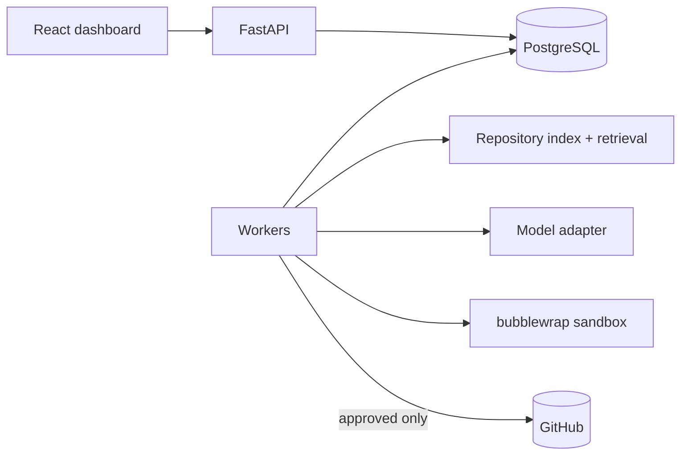

# genai-code-modernisation

An agentic software-maintenance platform: it indexes a real repository, plans a constrained change for a
maintenance request (dependency upgrade, deprecated API migration, bug fix, ...), edits an isolated working copy,
runs the project's checks in a sandbox, repairs failures within a bounded budget, verifies the result independently
and, after human approval, opens a draft pull request.

This is an independent engineering project. It has not been deployed to production and has no external users.

## What is implemented

| Capability | Where | Evidence |
| --- | --- | --- |
| Commit-aware repository index (tree-sitter symbols, imports, call/attribute references), incremental by git blob | `backend/src/modernisation/repository_intelligence` | `tests/integration/test_repository_intelligence.py` |
| Hybrid retrieval (BM25 + symbols + call sites + import graph + test links + manifests) with source references | `repository_intelligence/retrieval.py` | retrieval acceptance test; `POST /api/repositories/{id}/retrieve` |
| Durable task workflow on PostgreSQL (leases, optimistic transitions, checkpoints, event log) | `agents/` | `tests/integration/test_workflow.py`, `tests/recovery/` (32 scenarios) |
| Structured planning, SEARCH/REPLACE edits, bounded repair with test feedback, independent verification | `agents/workflow.py`, `agents/edits.py` | workflow tests; live-model test |
| Deterministic change policy (scope, protected paths, symlinks, test weakening) | `execution/policy.py` | unit + security tests |
| bubblewrap sandbox: unprivileged uid, no network, no host paths, rlimits, cgroup pids/memory, timeouts | `execution/sandbox.py` | `tests/security/` (29 executions, 27 scenarios) |
| Offline dependency environments from a wheelhouse; pytest/ruff/mypy/pip-check with baseline comparison | `execution/pyenv.py`, `execution/checks.py` | workflow tests |
| Provider-independent model adapter (OpenAI-compatible, Anthropic) with retries, validated structured output, token/cost accounting | `llm/` | unit tests; live test against a local model |
| GitHub integration: permission check, rate limits, idempotent branch push + draft PR + commit status, signed webhooks | `integrations/github/`, `api/routers/webhooks.py` | tests against a fault-injecting GitHub stand-in (live GitHub not yet verified, see below) |
| Human approval gates bound to the reviewed task version | `agents/approvals.py` | workflow + security tests |
| REST API and React dashboard (7 screens) on real data | `backend/src/modernisation/api`, `frontend/` | API tests, 24 component tests, 5 Playwright E2E tests |
| Benchmark harness: protected acceptance tests, validator, platform vs single-shot baseline, reports | `evaluation/`, `backend/src/modernisation/evaluation` | `evaluation/validation-report.json`, `reports/` |

Architecture: [`docs/ARCHITECTURE.md`](docs/ARCHITECTURE.md). Security model and residual risks:
[`docs/SECURITY.md`](docs/SECURITY.md). Design decisions: [`docs/TECHNICAL_DECISIONS.md`](docs/TECHNICAL_DECISIONS.md).



## Technology

Python 3.12, FastAPI, Pydantic, SQLAlchemy 2 + Alembic, PostgreSQL 16, tree-sitter, httpx, OpenTelemetry;
bubblewrap; React 18, TypeScript, Vite, TanStack Query; pytest, Vitest, Playwright; GitHub Actions; Docker Compose.
Every dependency's purpose is listed in `docs/TECHNICAL_DECISIONS.md`.

## Requirements

* Linux with unprivileged user namespaces (Ubuntu 24.04+: `sudo sysctl -w kernel.apparmor_restrict_unprivileged_userns=0`)
* `bubblewrap`, `git`, PostgreSQL 16, Python 3.12, [uv](https://docs.astral.sh/uv/), Node 22
* Root (or sudo) for workers: they drop to a dedicated sandbox uid before running repository code
* A model endpoint (optional for browsing/indexing; required for tasks)

## Local setup

```bash
# system
sudo apt-get install -y bubblewrap git postgresql
sudo groupadd --system --gid 9100 modsandbox
sudo useradd --system --uid 9100 --gid 9100 --no-create-home --shell /usr/sbin/nologin modsandbox

# database
sudo -u postgres psql -c "CREATE ROLE modernisation LOGIN PASSWORD 'modernisation-dev' CREATEDB"
sudo -u postgres psql -c "CREATE DATABASE modernisation OWNER modernisation"

# backend
cd backend && uv sync && .venv/bin/alembic upgrade head && cd ..

# offline wheelhouse for sandboxed dependency installs
scripts/build_wheelhouse.sh

# frontend
cd frontend && npm ci && cd ..
```

### Environment variables

All settings use the `MODERNISATION_` prefix (ambient credentials such as a CI `GITHUB_TOKEN` are deliberately
ignored). Copy `.env.example` to `.env`; the full list is in [`docs/OPERATIONS.md`](docs/OPERATIONS.md). Minimum:

```bash
export MODERNISATION_DATA_DIR=$PWD/.data
export MODERNISATION_WHEELHOUSE_DIR=$PWD/.data/wheelhouse
export MODERNISATION_ALLOWED_LOCAL_ROOTS='["/path/to/your/repositories"]'
```

### Model configuration

Local CPU model (what the measured evaluation used; Apache-2.0 weights from Hugging Face):

```bash
scripts/local_model_server.sh install
scripts/local_model_server.sh download 1.5b
scripts/local_model_server.sh start 1.5b          # OpenAI-compatible server on 127.0.0.1:8081
export MODERNISATION_MODEL_PROVIDER=openai_compatible
export MODERNISATION_MODEL_BASE_URL=http://127.0.0.1:8081/v1
export MODERNISATION_MODEL_NAME=qwen2.5-coder-1.5b-instruct-q4_k_m
export MODERNISATION_MODEL_STRUCTURED_OUTPUT=json_object_schema
```

Hosted endpoints: set `MODERNISATION_MODEL_BASE_URL`, `MODERNISATION_MODEL_NAME`, `MODERNISATION_MODEL_API_KEY`
(OpenAI-compatible, `MODERNISATION_MODEL_STRUCTURED_OUTPUT=json_schema`) or `MODERNISATION_MODEL_PROVIDER=anthropic`.
Set `MODERNISATION_MODEL_PRICE_INPUT_PER_MTOK` / `..._OUTPUT_PER_MTOK` to record cost per request.
Check connectivity with `backend/.venv/bin/python -m modernisation.cli check-model`.

### GitHub integration

```bash
export MODERNISATION_ALLOWED_GITHUB_REPOSITORIES='["your-org/test-repo"]'
export MODERNISATION_GITHUB_TOKEN=...            # fine-grained: contents, pull requests, commit statuses (rw); issues (r)
export MODERNISATION_GITHUB_WEBHOOK_SECRET=...   # webhook URL: https://<host>/api/webhooks/github
export MODERNISATION_GIT_AUTHOR_NAME=... MODERNISATION_GIT_AUTHOR_EMAIL=...   # identity on generated commits
```

Publication always requires an approval in the Code Review screen; pull requests are opened as drafts and are never
merged by the platform.

## Running

```bash
cd backend
.venv/bin/python -m modernisation.cli api --port 8000      # API
sudo -E .venv/bin/python -m modernisation.cli worker      # worker (root to drop to the sandbox uid)
cd ../frontend && npm run dev                               # dashboard on http://127.0.0.1:5173 (proxies /api)
```

Or with containers (PostgreSQL, migrations, API, worker, dashboard on http://127.0.0.1:8080):

```bash
cp .env.example .env
docker compose up --build        # BASE_REGISTRY=mirror.gcr.io/library if Docker Hub rate-limits
```

The compose worker needs relaxed seccomp/AppArmor settings for bubblewrap; read the security notes in
`docker-compose.yml` and `docs/SECURITY.md` first.

## Tests

```bash
cd backend
.venv/bin/ruff check src tests && .venv/bin/ruff format --check src tests && .venv/bin/mypy src
sudo -E .venv/bin/pytest -m "not live_llm and not db_restart"          # unit, PostgreSQL, sandbox, workflow, security, recovery
sudo -E .venv/bin/pytest tests/recovery -m db_restart                  # restarts the local PostgreSQL cluster
MODERNISATION_TEST_MODEL_BASE_URL=http://127.0.0.1:8081/v1 \
MODERNISATION_TEST_MODEL_NAME=qwen2.5-coder-1.5b-instruct-q4_k_m sudo -E .venv/bin/pytest tests/live

cd ../frontend
npm run typecheck && npm run lint && npm run format:check && npm run test && npm run build
npm run e2e                                                            # starts the real backend itself
```

Integration tests use a real PostgreSQL database (`MODERNISATION_TEST_DATABASE_URL`, default
`.../modernisation_test`) and the real sandbox; tests whose prerequisites are missing are skipped with the reason.

## Evaluation

```bash
scripts/build_wheelhouse.sh
cd backend && .venv/bin/python -m modernisation.evaluation validate --out ../evaluation/validation-report.json
RUN_TAG=<tag> ../scripts/run_evaluation.sh        # platform + baseline on all 100 tasks, then reports
MODES="oracle platform baseline" RUN_TAG=<tag> ../scripts/run_evaluation.sh   # adds the oracle harness check first
```

Protocol, success definition and integrity controls: [`docs/EVALUATION_PROTOCOL.md`](docs/EVALUATION_PROTOCOL.md).
Results: [`reports/evaluation.md`](reports/evaluation.md); per-task evidence: `reports/runs/*.jsonl`.

## Security limitations

The sandbox shares the host kernel (no microVM boundary, no seccomp filter inside it), has no disk quota and limits
CPU only by wall-clock time. Do not point the platform at untrusted third-party repositories without the additional
controls listed in [`docs/SECURITY.md`](docs/SECURITY.md). The API is single-tenant with an optional bearer token; there
is no user management or RBAC.

## Known issues

See [`PROGRESS.md`](PROGRESS.md) for the current status of every milestone, blocked items and open issues, and
[`docs/FAILURE_ANALYSIS.md`](docs/FAILURE_ANALYSIS.md) for observed failure modes.

## Troubleshooting

| Problem | Fix |
| --- | --- |
| `bwrap: No permissions to create a new namespace` | enable unprivileged user namespaces (sysctl above); in Docker see the worker `security_opt` |
| Sandbox tests skipped | run pytest as root and build the wheelhouse |
| `environment step failed ... ResolutionImpossible` | the wheelhouse lacks a pinned version; add it to the relevant `wheelhouse.txt` and rerun `scripts/build_wheelhouse.sh` |
| Task stays in PLANNING with "no model endpoint is configured" | set the `MODERNISATION_MODEL_*` variables and restart the task |
| `409 repository is not indexed` | `POST /api/repositories/{id}/index` (or "Index" in the explorer) |
| `403 ... not under an authorised local root` | add the parent directory to `MODERNISATION_ALLOWED_LOCAL_ROOTS` |

## Future improvements

* microVM-isolated workers and per-job disk/CPU quotas
* additional language support in the index (tree-sitter grammars exist; only Python is parsed today)
* retrieval ablations, including whether embeddings improve recall on the benchmark
* evaluation with larger hosted models (the adapter supports them; no credentials were available for this work)
* worker registry and push-based event streaming for the dashboard

## Licence

MIT, see [`LICENSE`](LICENSE).
