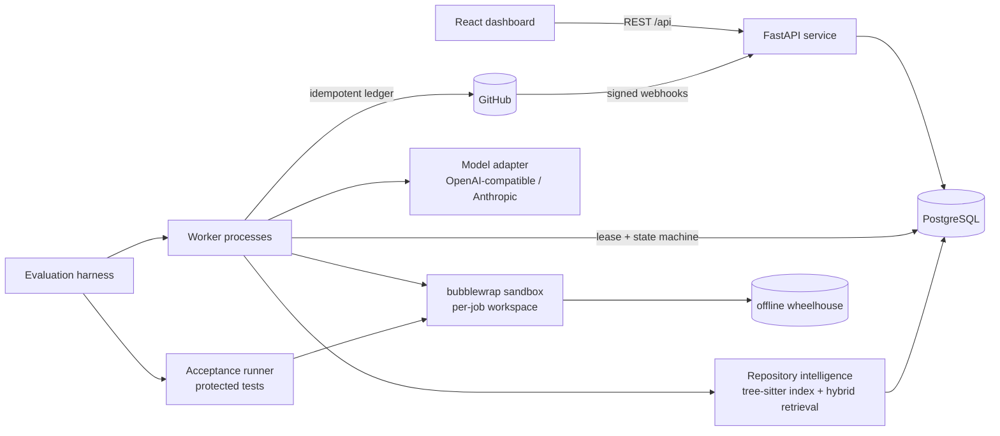
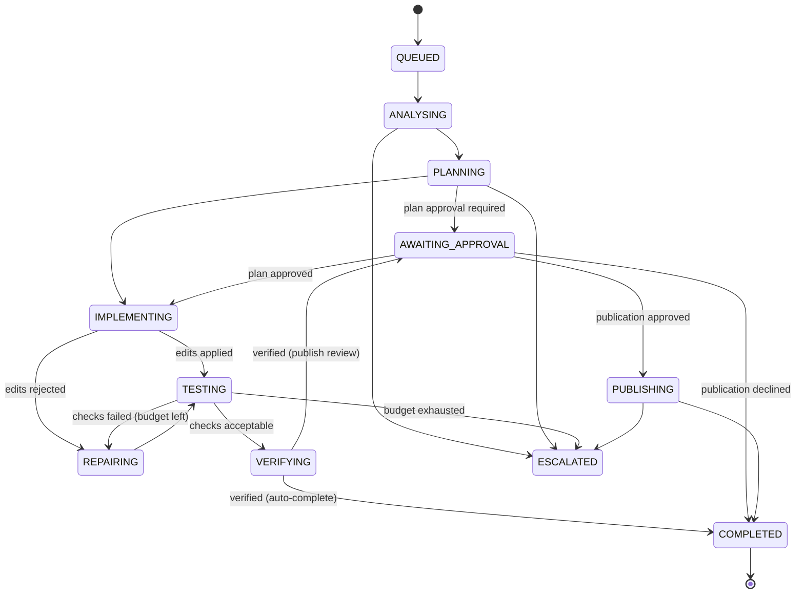

# Architecture

## Overview

Every component is a module of the `modernisation` Python package (`backend/src/modernisation`), plus the
`frontend/` single-page application.

| Module | Responsibility |
| --- | --- |
| `api/` | REST endpoints, request validation, optional bearer-token guard for mutations, webhook receiver |
| `db/` | SQLAlchemy models; Alembic migrations in `backend/migrations` |
| `repository_intelligence/` | git plumbing on bare mirrors, tree-sitter parsing, commit-aware incremental index, hybrid retrieval, impact analysis |
| `agents/` | task states and transitions, durable store (leases, checkpoints, events), workflow engine, prompts, edit protocol, approvals, worker |
| `execution/` | sandbox, workspaces, change policy, dependency environments, check pipeline and baseline comparison |
| `llm/` | provider-independent client protocol, HTTP providers, structured-output validation, accounting sink |
| `integrations/github/` | REST client (rate limits), publication ledger (branch push, draft PR, commit status) |
| `evaluation/` | benchmark task set, validator, runner (platform vs baseline), acceptance runner, metrics and reports |

## Data model

PostgreSQL is the source of truth; files on disk (mirrors, workspaces, environments) are caches.

* `repositories`, `index_snapshots` (one per repository commit), `blobs` (content-addressed by git blob SHA, with
  parse status), `blob_symbols`, `blob_imports`, `blob_references`, `snapshot_files` (path → blob per snapshot).
* `tasks` (state, approval stage, lease owner/expiry, optimistic `version`, plan/analysis/result JSON, final diff),
  `task_events` (append-only log shown in the execution monitor), `task_checkpoints` (completed step outputs),
  `patch_attempts`, `check_runs`, `model_calls`, `approvals`.
* `external_actions` (side-effect ledger with unique idempotency keys), `webhook_deliveries` (unique delivery id).
* `evaluation_runs`, `evaluation_results`.

## Repository intelligence

1. A repository is mirrored (`git clone --mirror`) into the data directory. Registration is restricted to configured
   local roots (resolved through symlinks) and an allowlist of GitHub repositories.
2. Indexing a commit lists the tree with `git ls-tree`, reads new blobs through one `git cat-file --batch` process
   and parses Python blobs with tree-sitter into symbols (class/function/method/module variable with qualified names,
   signatures, docstrings, line ranges), imports (absolute and relative) and references (calls and attribute access
   with their receiver). Blobs already parsed for any earlier snapshot are reused; measured on the test fixture,
   re-indexing after a one-file change parses 1 blob and reuses 7.
3. Retrieval (`retrieval.retrieve`) merges six signals: BM25 over identifier-aware tokens (snake/camel-case split,
   path tokens weighted), symbol definitions named in the request, call sites of dotted names (`datetime.utcnow`),
   modules importing a named package (distribution → import name map), dependency manifests/config files, and tests
   that import or reference the top implementation files. Results carry repository, commit, path, symbol, line range
   and method(s). Credential/key files are never returned.
4. Impact analysis walks the import graph (two levels) and symbol references to list dependents and tests.

Embeddings are not used. The design brief required keyword and structure-aware retrieval first; adding a vector
index is only justified if an ablation on the benchmark shows a gain (not done).

## Durable workflow

Every non-terminal state can also move to `CANCELLED` or `FAILED`; terminal `FAILED`/`CANCELLED`/`ESCALATED` tasks
can be restarted to `QUEUED`.

* **Claiming**: workers select runnable tasks with `SELECT ... FOR UPDATE SKIP LOCKED` where the lease is free or
  expired, and hold a time-limited lease renewed by a heartbeat thread.
* **Transitions** are single `UPDATE ... WHERE id=? AND version=? [AND lease_owner=?]` statements. A worker that lost
  its lease cannot write (it receives `StaleTask`).
* **Checkpoints** store each step's output before the transition, so a crash between the two does not repeat work
  (for example a model call).
* **Workspaces are rebuilt** from the base commit plus the recorded diff before every attempt and on resume; files
  left on disk by a crashed worker or by test runs never enter a patch.
* **Bounded work**: attempt budget per task (default 3); five transient failures move a task to `FAILED`; a hard
  step limit per worker drive; repeated policy violations escalate early.

## Patch execution

1. The model returns SEARCH/REPLACE blocks (whole-file blocks are accepted as a fallback only if no existing Python
   definition is dropped).
2. Every edit passes the deterministic change policy: no absolute paths, `..`, symlink components, `.git`, CI workflows,
   key/credential files; inside `allowed_paths`; not deleting or weakening tests (`skip`, `xfail`, removed `test_*`).
3. The diff is computed by git from the workspace (content re-hashed, never trusting the stat cache).
4. Checks run in the sandbox: syntax check of changed Python files, pytest with JUnit output, project-configured ruff and
   mypy, and `pip check`. Results are compared with the **baseline** run at the base commit, so pre-existing failures
   are not attributed to the change and newly failing or removed tests are.
5. Failures are summarised (failing test ids, assertion messages, tracebacks, timeouts) and fed into a repair prompt
   with the current file contents; the budget bounds the loop.
6. **Independent verification** re-applies the final diff to a fresh clone, re-audits the diff against the policy and
   reruns the checks before the task can complete.

## Evaluation harness

Benchmark tasks (`evaluation/`) are materialised as single-commit repositories, registered with the platform and driven
by the same worker code. The resulting patch is then evaluated in a separate sandbox against protected acceptance tests
(never mounted into agent workspaces) plus the repository's own suite. See `docs/EVALUATION_PROTOCOL.md`.
